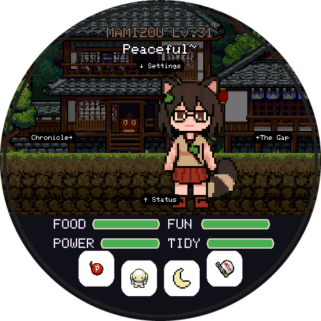
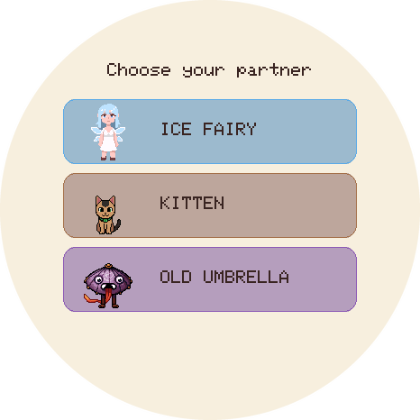

# TamaTouhou

A virtual pet for the **Waveshare ESP32-S3-Touch-AMOLED-1.75**: a round 466 × 466 touch screen, battery-powered, about the size of a pocket watch. Raise a pet, keep it happy, watch it awaken into a youkai, and collect all 48 species, then all 48 again in their rare colours.

Free and open source. Comes with a Touhou Project fan theme, and the engine supports other themes.

<p align="center">
  
  &nbsp;&nbsp;
  
</p>

## Install it on your board

**Open the [web flasher](https://mintymint1.github.io/TamaTouhou/) in Chrome or Edge, plug the board in with USB-C, and click Install.** That's all; no software to install. Updates keep your pet.

No Chrome? Every [release](https://github.com/mintymint1/TamaTouhou/releases/latest) has the images plus a one-line esptool script. Details and troubleshooting: **[docs/flashing.md](docs/flashing.md)**.

## Play

| | |
|---|---|
| **Care** | Four needs (FOOD, FUN, POWER, TIDY), four buttons (feed, play, sleep, clean), and petting |
| **Grow** | One level per hour. Hit the awakening level with every need at 40+ and the pet transforms; some lines branch |
| **Collect** | 48 species in four rarity tiers up to the mythic Reimu and Marisa, each in a rare colour too. Eggs never repeat what you have |
| **Keep** | Evolved pets leave a keepsake in THE GAP; switch any stored creature back in |
| **Goodbyes** | Farewell blesses the next egg, neglect makes the pet run away, or release it |

Swipe from the pet: up for Status, left for THE GAP, right for the Chronicle, down for Settings.

Full rules, numbers and tips: **[docs/how-to-play.md](docs/how-to-play.md)**.

## Run the code

No board needed: the simulator runs the same game in a window on macOS, Linux or Windows.

```bash
git clone https://github.com/mintymint1/TamaTouhou.git && cd TamaTouhou
make setup     # once: Python venv with the theme tools and PlatformIO
make run       # the game in a window (needs cmake and a C++17 compiler)
make test      # unit tests
make flash     # build and write it to a board on USB
```

Code tour, simulator keys, tests and hardware notes: **[docs/development.md](docs/development.md)**.

## Repository

```
firmware/    the game: engine, screens, board drivers, simulator, tests
themes/      theme packs (art + YAML); touhou/ is the default
tools/       theme builder, rare-colour generator, sprite checks, save backup, release packager
web/         the web flasher page (published to GitHub Pages by the release workflow)
docs/        how-to-play, flashing, development, themes, design
```

## Contributing

Bug reports, play-testing, code, new themes and hand-drawn art are all welcome. Read **[CONTRIBUTING.md](CONTRIBUTING.md)** first: it covers what the game is (and isn't), the code rules and the art rules.

Making your own theme? **[docs/themes.md](docs/themes.md)** has the format and a checklist.

## Status

| Part | State |
|---|---|
| Game rules | Complete, covered by 103 host tests, including whole-game playthroughs |
| Simulator | Playable |
| Board firmware | Builds; first hardware run pending, so expect fixes |
| Touhou theme | 48/48 species animated, each with a rare colour (AI-generated first version, see [its README](themes/touhou/README.md)) |

## Tools used

- **AI:** this project was made with the help of AI tools. An AI coding assistant helped write and review the code, tests and documentation, and the Touhou sprites were generated with an AI pixel-art tool (PixelLab), then processed and checked with this repository's own tools. Hand-drawn art and human review are welcome; see [CONTRIBUTING.md](CONTRIBUTING.md).
- **Build and test:** PlatformIO with the pioarduino Arduino-ESP32 core, CMake + SDL3 for the simulator, Python (Pillow, PyYAML) for the theme tools.
- **Flashing:** [ESP Web Tools](https://esphome.github.io/esp-web-tools/) and esptool.

## Credits and license

- **Code:** [MIT](LICENSE). The engine and board drivers started as a port of [TamaPoke](https://github.com/socquique/TamaPoke) by Quique Tortosa (MIT); other libraries are listed in [THIRD_PARTY_NOTICES.md](THIRD_PARTY_NOTICES.md).
- **Art** (`themes/`, and the screenshots): [CC BY-NC 4.0](themes/LICENSE). Free to share and remix, not to sell.
- **Touhou Project** belongs to ZUN / Team Shanghai Alice. This is an unofficial, non-commercial fan work.
- Not affiliated with Bandai ("Tamagotchi" is their trademark) or Waveshare.
