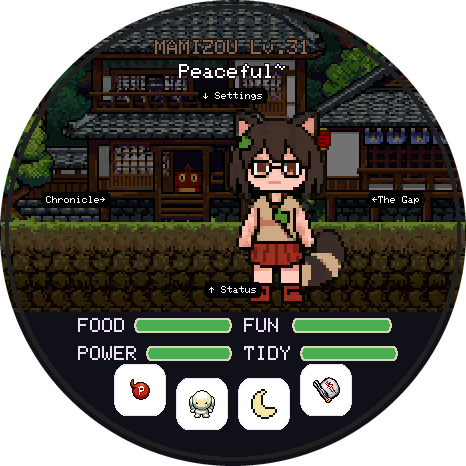

# How to play

You look after one pet at a time. Keep its needs up and it grows, levels up and eventually **awakens** into a youkai. Every form you raise is added to your collection. The goal is to find all 48 species, then all 48 again in their rare colours.

Words in CAPITALS are what the Touhou theme calls things on screen. Other themes can use other words; the rules stay the same.

## Contents

- [The screen](#the-screen)
- [Starting out](#starting-out)
- [The four needs](#the-four-needs)
- [Taking care](#taking-care)
- [Mood, mess and weight](#mood-mess-and-weight)
- [Care mistakes](#care-mistakes)
- [Growing up and awakening](#growing-up-and-awakening)
- [Goodbyes](#goodbyes)
- [Eggs and rarity](#eggs-and-rarity)
- [Collecting everything](#collecting-everything)
- [THE GAP (storage)](#the-gap-storage)
- [Bond, streaks and medals](#bond-streaks-and-medals)
- [The other screens](#the-other-screens)
- [Time, sleep and power](#time-sleep-and-power)
- [Tips](#tips)

## The screen

The top shows the pet's name and level, with a short status line below it ("Peaceful~", "Hungry..."). The pet walks around in its home (its habitat). The bottom panel holds:

- **four need bars:** FOOD, FUN, POWER and TIDY;
- **four buttons:** feed, play, sleep and clean.

**Swipe** from the main screen to open other screens: up for Status, left for THE GAP, right for the Chronicle, down for Settings. The opposite swipe takes you back. Inside a screen, swipe along the other direction to turn pages. Small arrows at the edges show where each screen is until you've opened it once.

## Starting out

On your first game you choose a partner from three starters: **ICE FAIRY**, **KITTEN** or **OLD UMBRELLA**.

After that, every new pet starts as an egg (a **YIN-YANG ORB**). Tap it three times, or wait three minutes, and it hatches.

## The four needs

| Need | Touhou name | What lowers it (while awake) |
|---|---|---|
| Food | FOOD | 2 points a minute |
| Joy | FUN | 1 a minute, plus 2 more while FOOD is under 30, plus 2 more while TIDY is under 30 |
| Energy | POWER | 1 a minute, 2 if the pet is chubby (weight over 50) |
| Hygiene | TIDY | 1 a minute, plus 4 for each mess on the ground |

Every need runs from 0 to 100. The bars turn amber, then red, as they drop. An awake pet that nobody looks after gets hungry within the hour, so check in often, or put it to sleep (see [Time, sleep and power](#time-sleep-and-power)).

## Taking care

| Action | How | Effect |
|---|---|---|
| **Feed** | Feed button, then pick one of three foods (POWER ITEM, POINT ITEM, FAITH ITEM) or the treat (DANGO) | Food +25. Each species has a secret **favourite food**: +35 food, +10 fun, a heart and bond. Finding it earns a medal. |
| **Treat** | Feed button, then DANGO | Food +10, fun +12, but weight +12 |
| **Play** | Play button | A keepy-uppy minigame: tap the object to keep it in the air. Three drops and it's over. Fun goes up with your score (up to +35), and so does tiredness. Playing burns weight. |
| **Sleep** | Sleep button (tap again to wake) | POWER refills fast; the other needs drop about four times slower and stop at a floor (FOOD 30, FUN 35, TIDY 45). |
| **Clean** | Clean button (BOMB!) | Clears all mess, TIDY back to 100 |
| **Pet it** | Tap the pet | Fun +5, a heart |

You can't feed a sleeping pet, and nothing works during an egg or a goodbye.

## Mood, mess and weight

- **Mess:** a well-fed pet sometimes leaves a mess (up to three, shown on the ground). Each one makes TIDY drop much faster. Clean it up.
- **Weight:** treats add weight; it goes down slowly over time and faster when you play. Above 50 the pet tires faster; above 60 it's "Too much dango".
- **Mood:** the status line shows the most urgent problem: hungry, needs a clean, out of power, or lonely when any need is under 25. A sad pet plays its sad animation.

## Care mistakes

When any need falls to **10 or less**, that's a **care mistake** (at most one per hour). Each one:

- delays awakening by **one level**;
- costs a point of bond;
- rules out the "fit" medal for that pet.

The Status screen shows the count.

## Growing up and awakening

A pet gains **one level per hour** of age, asleep or awake.

Most species can **awaken** (evolve) into a youkai. A pet is ready when:

1. its level is at least the species' awakening level (16 to 30, depending on the line) **plus one level per care mistake**;
2. **every need is 40 or more**;
3. it's awake.

An **AWAKEN!** button then appears on the main screen. Tap it to watch the change, or pick "Not yet" to wait (it asks again at the next level).

Some lines **branch**. A KITTEN can become CHEN or ORIN, a RABBIT can become TEWI or REISEN, and a CROW CHICK can become AYA or OKUU. The pet always picks the form you haven't collected yet. When a pet awakens, its old form stays behind as a **keepsake** in THE GAP, so you can raise it again later and take the other branch.

Rare, legendary and mythic species are single forms: they hatch as what they are and don't awaken.

## Goodbyes

A pet can leave in three ways. Each one ends your time with that pet and starts a new egg.

| Ending | When | What it does to the next egg |
|---|---|---|
| **Farewell** ("wants to explore") | A final form (nothing left to awaken into) that's at least **3 days** old offers it. Choose "See you!" or "Stay a while" (it asks again a day later). | **Blessed:** better odds of a rare egg, and twice the chance of a rare colour |
| **Runaway** (INCIDENT!) | All four needs at **0 for a full hour**. A button warns you first; **any single act of care cancels it**. | **Cursed:** the next egg is always from the most common tier |
| **Release** | Hold the pet for **3 seconds**, then confirm | Neutral |

A pet that leaves is still in your collection. It's only gone from THE GAP.

## Eggs and rarity

Every species belongs to a rarity tier. When an egg is made, the game rolls the tier, rarest first:

| Tier | Chance | Blessed chance (after a farewell) | Unlocks after collecting |
|---|---|---|---|
| Mythic ("PROTAGONIST?!"): Reimu, Marisa | 1 % | 2.5 % | 30 species |
| Legendary | 4 % | 10 % | 10 species |
| Rare | 25 % | 40 % | from the start |
| Common | the rest | the rest | from the start |

- Your **daily streak** and your pet's **bond** raise these chances by up to 50 %.
- Every egg has a small chance to hatch in a **rare colour** (ALT COLOR, marked with ★ and a `*` before the name): 1 in 48 normally, and up to 1 in 8 with a farewell blessing, a long streak and high bond.
- Eggs **never repeat** a species you already have in that colour. If a tier has nothing new left, the egg comes from the nearest tier that does.
- The egg screen hints at rare eggs ("RARE", "LEGENDARY", "PROTAGONIST?!").

## Collecting everything

Your progress has three phases:

| Phase | Eggs give you |
|---|---|
| **1. Normal** | Species you don't have yet in normal colour (with the odd lucky rare colour) |
| **2. Rare colours** | Once every normal colour is found: only rare colours you don't have yet |
| **3. Complete** | Once all 96 are found (48 species × 2 colours): **you choose** any base form and colour for every new egg |

Awakened forms come from awakening, not from eggs: a rare-colour KITTEN awakens into a rare-colour CHEN.

How long it takes depends on how often you play. With near-perfect care it's about a month; checking in a few times a day, about three months.

## THE GAP (storage)

THE GAP holds the creatures you're keeping. Swipe **left** to open it.

- **Keepsakes:** each time a pet awakens, its previous form is kept here.
- **Frozen in time:** creatures in THE GAP don't age, get hungry or make messes. Only your active pet needs care.
- **One of each:** at most one per species and colour (96 places for the Touhou theme). If a second one arrives, the game asks whether to replace the stored one.
- **Switch:** tap a creature, then SWITCH. Your active pet goes into THE GAP exactly as it is, and the chosen one comes out.
- **Store + new egg:** sends your active pet to THE GAP and starts a fresh egg. You earn this by raising: the pet must have **awakened** since it hatched or left THE GAP. If it has nothing left to awaken into, it needs **9 levels' worth of time** as your active pet instead. That's what stops endless free eggs.
- **Release from THE GAP:** hold a creature, then confirm.
- You can't store or switch while the egg is still unhatched ("Hatch the orb first").

## Bond, streaks and medals

- **Bond (0 to 100)** belongs to each pet. It grows with care: +4 the first time you care for it each day, plus small amounts for favourite food, play, cleaning and petting (at most 20 a day from those). Care mistakes lower it.
- **Streak:** care for your pet on consecutive days. 3, 7, 30 and 100 days in a row each get a celebration ("n-day shrine visit streak!"). Miss a day and it starts again from 1.
- **Medals (SPELL CARD GET!):** each pet can earn eight:

| Medal | How |
|---|---|
| Level 10, 25, 50 | Reach that level |
| Favourite | Discover its favourite food |
| Streak | A 7-day streak |
| Best friends | Bond 100 |
| Final form | Reach a form with nothing left to awaken into |
| Fit | Weight 0 at level 5 or more, with no care mistakes |

## The other screens

**Status** (swipe up). Swipe left and right through five pages:

1. **Next up:** the three nearest goals, with progress bars and time estimates (next level, awakening and what's blocking it, streak, medals).
2. **Care:** the needs with numbers, weight, mess and care mistakes.
3. **Growth:** level, age, and the evolution line (unknown forms show as silhouettes).
4. **Bond & streak:** bond, today's bond, streak, best streak and medals.
5. **Collection:** how many species and rare colours you've found, what's in THE GAP, and which tiers are unlocked.

**Chronicle** (swipe right): every species in the theme. Ones you've never had show as a black silhouette; ★ marks a rare colour found. Tap one for its details. **Hold** a creature that's in THE GAP for a second to switch it in.

**Settings** (swipe down):

| Row | What it does |
|---|---|
| Clock | Tap left of centre for −1 hour, right for +1 hour; the outer ends change the minutes |
| Sound | On or off |
| Brightness | Auto, low, mid or high |
| Progress ring | A thin ring around the edge of the main screen showing the next goal |
| Rotate screen | Turns the picture a quarter turn per tap, for standing the board on another edge |

Any screen goes back to the pet after 30 seconds without a touch.

## Time, sleep and power

- **One game minute is one real minute.** The pet lives on real time, day and night.
- **Asleep is the safe mode.** Needs drop slowly and stop at a floor, so a sleeping pet can't starve. Put it to bed at night or when you leave it alone for a while, and wake it when you're back. It still gains levels while asleep, but it can't awaken until it's awake again.
- **The screen** dims after 90 seconds and nearly switches off after 5 minutes, to protect the AMOLED from burn-in. Touch it to wake it; that first touch only wakes the screen. A short press of **PWR** turns the screen off or on, and holding PWR for 4 seconds switches the board off.
- **Switched off:** when the board starts again, the time it was off is applied gently. Needs drop, but not below 15, so nothing dies. There are no care mistakes, awakenings or runaways while it was off, and at most 14 days count.
- **Set the clock** in Settings after the battery has run flat (the board's clock has no backup battery). Your pet never loses time when the clock is set back.
- **Battery:** a 3.7 V LiPo on the board's battery connector charges from USB-C, even while you play. Settings shows the level.

## Tips

- Leaving the board alone for a while? **Put the pet to sleep.**
- Try every food once: the favourite gives the most food and fun, and a medal.
- Feed and clean before an awakening level comes up, so every need is 40 or more when it does.
- Avoid care mistakes on long lines: each one adds a level to the wait.
- Treats are tempting but make the pet chubby. Play to work it off.
- Checking in every day keeps your streak going, and the streak improves your egg luck.
- Want both branches of a line? Let it awaken, then switch its keepsake back in from THE GAP and raise it again.
- Say farewell to final forms you don't need to keep. It blesses the next egg.
